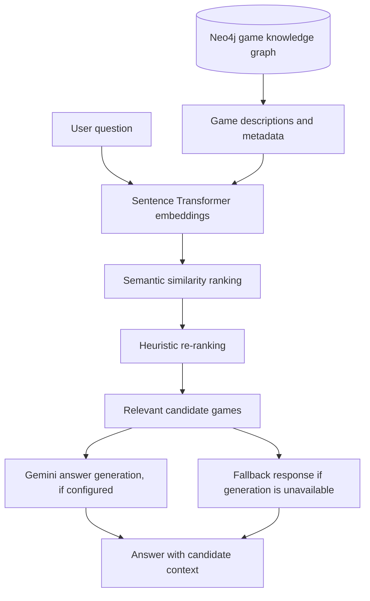
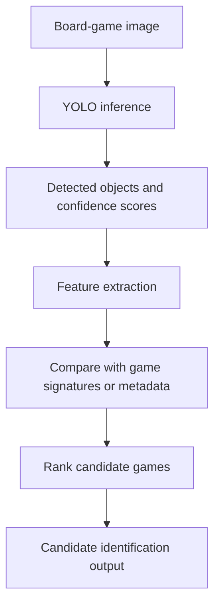
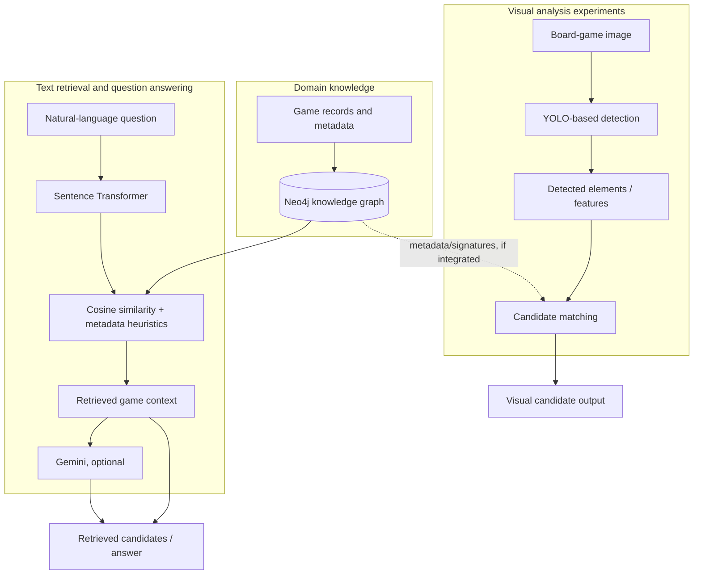
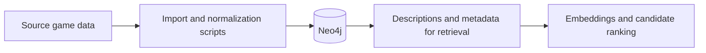

# LUDII Game Intelligence

### Exploring AI methods for historical board-game identification and discovery

LUDII Game Intelligence is an experimental AI project that brings together semantic retrieval, a knowledge graph, computer-vision components, and large-language-model-assisted question answering to explore historical board games.

The central idea is to connect different kinds of evidence about a game—such as its description, rules, region, historical period, and visual characteristics—so that users can explore related games and ask questions in natural language.

> ****Status:**** research/portfolio prototype. The repository contains several AI-related components at different levels of integration. This README distinguishes implemented behavior from intended workflows; it does not claim validated model accuracy or a fully automated end-to-end system.

## What the project explores

- ****Semantic retrieval:**** finding potentially relevant games from a natural-language query rather than relying only on exact keyword matches.

- ****Knowledge-graph-supported exploration:**** using Neo4j to represent games and their relationships to rules, regions, periods, and other metadata.

- ****LLM-assisted question answering:**** using retrieved game information as context for a Gemini-generated response when the provider is configured and available.

- ****Computer vision:**** experimenting with YOLO-based detection of visual elements in board-game imagery, as a possible signal for identifying candidate games.

- ****3D representation:**** exploring board geometry and GLB export through the project's 3D-related code.

These are complementary experiments, not evidence that every modality is already connected into one reliable multimodal model. In particular, the visual identification and 3D-reconstruction paths need end-to-end validation before they can be described as fully automated.

## AI pipeline at a glance



This diagram represents the text-retrieval path implemented in `phase1_ludii_rag/hybrid_rag.py`: game information is retrieved from Neo4j, descriptions are embedded with `all-MiniLM-L6-v2`, candidates are ranked using cosine similarity and adjusted with metadata-related heuristics, and retrieved context can be passed to Gemini. A fallback path is present if LLM generation is unavailable.

## 1. Semantic retrieval and RAG

The `HybridRAG` module is the clearest AI pipeline in the repository.

### Current implementation

1\. ****Corpus preparation:**** game records and selected metadata are read from Neo4j.

2\. ****Text representation:**** descriptions are built from available game properties.

3\. ****Embedding:**** Sentence Transformers' `all-MiniLM-L6-v2` model encodes the query and game descriptions into vectors.

4\. ****Candidate ranking:**** cosine similarity is used to rank descriptions by semantic relevance.

5\. ****Heuristic adjustment:**** signals such as a matching game name, region, or historical period can affect the ranking.

6\. ****Answer generation:**** when configured, Gemini receives the question and retrieved context to generate a natural-language answer. A fallback is used when generation is unavailable.

This is a ****hybrid retrieval approach**** because semantic similarity is combined with explicit metadata heuristics. It should not be described as a trained domain-specific embedding model or as a fully graph-native GraphRAG implementation unless those claims are demonstrated by the code and evaluation.

### What still needs evaluation

The presence of an embedding model or an LLM does not by itself establish retrieval quality. Useful next steps are to build a small, manually checked set of questions and relevant games, then measure Recall@k, Precision@k or MRR. LLM answers should separately be checked for factual support by the retrieved records, hallucinations, and consistency across repeated queries.

## 2. Knowledge graph as the domain knowledge layer

Neo4j stores game information and relationships used by the retrieval and import code. Import scripts under `phase4_neo4j/` cover game records and related information such as signatures, regions, periods, and rules/features.

The graph is a structured knowledge source; it is not itself an AI model. Its value depends on the quality of the imported data, the relationships represented, and whether the retrieval pipeline uses those relationships effectively.

The repository documentation reports the following corpus figures, which should be treated as ****documented counts, not independently verified evaluation results****:

- 1,621 games

- 3,337 rulesets

- approximately 16,739 relationships

- 28 regions and 13 historical periods

Counts can differ depending on the import state and database contents. Recalculate them directly from the active Neo4j instance before using them in a presentation or CV, and resolve any discrepancies between the README, UI, and database.

## 3. Computer vision experiments

The `phase2_vision/` directory contains YOLO-oriented detection code for board-game elements, including board/piece detection-related modules. The API also includes a game-identification path.

The intended AI flow is:



This is the conceptual workflow, not a claim of measured performance. Before reporting an image-based identification result, verify that the endpoint actually accepts the image, runs the model, transforms detections into the features expected by the matching logic, and returns traceable candidates. If the current endpoint accepts pre-extracted JSON features rather than an image file, document that as the actual interface.

### Evaluation needed

For a meaningful computer-vision result, document the dataset and annotation procedure, train/validation/test split, model checkpoint, class definitions, and metrics such as precision, recall, and mAP. For game-level identification, also measure top-1 and top-k accuracy on held-out images. No accuracy figure should be claimed unless it has been measured on a clearly defined test set.

## 4. 3D board representation

The repository contains 3D-related code using Trimesh and a `reconstructed.glb` artifact. This indicates exploration of board geometry/export, but the presence of a GLB file alone does not prove that arbitrary input images can be reconstructed automatically or accurately.

A stronger experiment would define what is reconstructed, what inputs are required, how geometry is inferred, and how the output is validated against reference boards. Until then, present this as an exploratory component rather than a completed AI reconstruction model.

## 5. Overall architecture and data flow



The text RAG path is the most clearly described end-to-end AI component. The dashed connection between the graph and visual matching is conditional on the current integration and must be confirmed by a working test. The visual path should not be assumed to feed the RAG path automatically.

### Data preparation flow



Data quality is a core part of this project: missing descriptions, inconsistent names, duplicate game records, or incomplete region/period metadata can directly affect retrieval and matching quality.

## 6. Repository map

\| Path | AI/data role |

\|---|---|

\| `phase1_ludii_rag/hybrid_rag.py` | Semantic retrieval, candidate ranking, and LLM-assisted answer generation |

\| `phase2_vision/` | YOLO-oriented detection and experimental board/piece analysis |

\| `phase3_api/` | API wrappers exposing retrieval and vision functionality for the application |

\| `phase4_neo4j/` | Data import scripts for the game knowledge graph |

\| `phase5_n8n/` | Workflow automation experiments; role in the core AI path should be verified |

\| `phase6_advanced/` | Additional/advanced experiments; individual components should be evaluated independently |

\| `models/` | Model-related files, depending on the repository contents |

\| `tests/` | Automated tests; test coverage and AI evaluation coverage should be reviewed separately |

\| `app.py` | Streamlit interface for interacting with available functionality |

The API and interface are supporting layers. The main project story is the use of structured game knowledge, semantic retrieval, LLM-assisted answers, and visual-detection experiments—not the web framework itself.

## 7. Running the prototype

The following commands reflect the repository's documented development workflow; exact prerequisites and environment variables should be checked against the current files.

### Environment

Use Python 3.11 if compatible with the dependency versions in the repository. Create and activate a virtual environment:

```bash

python -m venv .venv

```

Windows PowerShell:

```powershell

.\\.venv\Scripts\Activate.ps1

pip install -r requirements.txt

```

macOS/Linux:

```bash

source .venv/bin/activate

pip install -r requirements.txt

```

### Supporting services and data

If using the supplied Compose setup, review `docker-compose.yml` before starting it. Configure Neo4j credentials using environment variables or a local `.env` file; do not reuse example credentials in a public deployment.

Run the data import scripts only after confirming their input files and prerequisites:

```bash

python phase4_neo4j/import_mysql_to_neo4j.py

python phase4_neo4j/import_lud_signatures.py

python phase4_neo4j/import_regions_periods.py

python phase4_neo4j/import_rules_features.py

```

The imports may depend on source datasets or an existing database. Check the scripts before running them and verify the resulting graph with queries.

### Launch the prototype

Start the API:

```bash

uvicorn phase3_api.main:app --reload --host 127.0.0.1 --port 8000

```

Open the interactive API documentation at `http\://localhost:8000/docs` when the API is running.

In a separate terminal, launch the interface:

```bash

streamlit run app.py

```

Some components may require model weights, API keys, or separately running services. The app starting successfully does not guarantee that every AI path is configured or operational.

## 8. Configuration and responsible claims

- Keep Gemini API keys and database credentials in environment variables; never commit secrets.

- Check that the Neo4j connection settings match the local environment.

- Treat generated answers as suggestions grounded in retrieved records, not as verified historical facts.

- Keep the original source record or game metadata available so users can inspect why a candidate was returned.

- Report model versions, dataset splits, evaluation metrics, and failure cases for any claimed AI performance.

- Distinguish model outputs from heuristic ranking signals; they are different sources of evidence.

## 9. Current limitations and next AI milestones

- [ ] ****Retrieval benchmark:**** create a manually reviewed query-to-game dataset and report Recall@k, MRR, and representative failure cases.

- [ ] ****Ablation study:**** compare semantic similarity alone against semantic similarity plus metadata heuristics.

- [ ] ****Grounded generation evaluation:**** measure whether Gemini answers are supported by retrieved game records; include a no-answer/low-confidence path.

- [ ] ****Graph-aware retrieval:**** verify whether relationships in Neo4j influence candidate selection, rather than merely supplying flat metadata. Only then describe the implementation as GraphRAG.

- [ ] ****Vision benchmark:**** document the YOLO checkpoint, dataset, labels, test split, precision/recall/mAP, and failure cases.

- [ ] ****Game identification benchmark:**** measure top-1/top-k accuracy on held-out board images and compare against a simple baseline.

- [ ] ****Multimodal integration test:**** demonstrate, with a reproducible example, how detections are converted into game candidates and whether graph data is used.

- [ ] ****3D validation:**** define the input assumptions and compare generated geometry with a reference board.

- [ ] ****Data validation:**** check duplicates, missing metadata, graph integrity, and consistency between documented counts and the actual database.

- [ ] ****Reproducibility:**** document model versions, configuration, dataset sources, random seeds where applicable, and exact steps to reproduce evaluation.

## 10. Project positioning

A precise description of the current work is:

> An experimental AI project for exploring historical board games through semantic retrieval, knowledge-graph-backed metadata, LLM-assisted question answering, and YOLO-based visual-analysis components.

This wording highlights the AI work without claiming that the project is a production-ready multimodal system, that the vision model has a particular accuracy, or that every component is fully integrated.

## License and data sources

Add the applicable code license and document the provenance and usage terms of the game data, model weights, and other third-party assets. Do not imply that source datasets or model assets are covered by the project's code license unless their terms confirm it.
