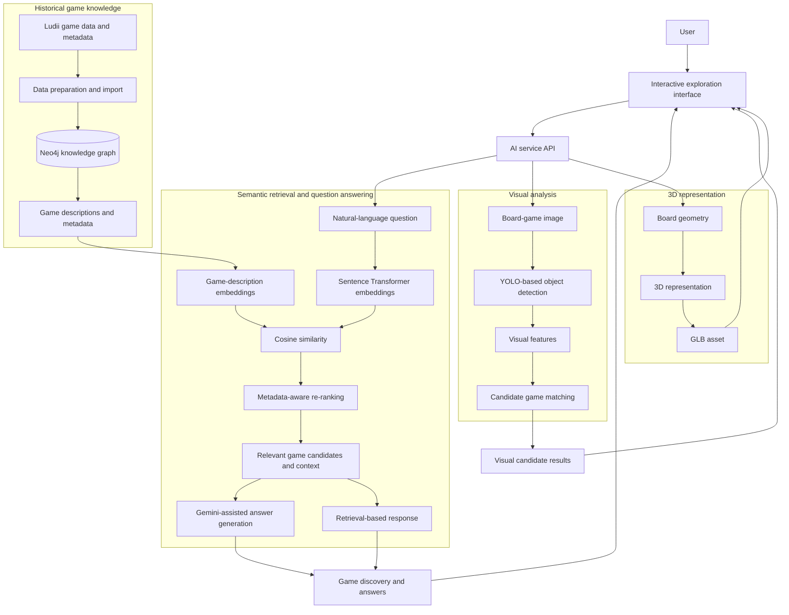
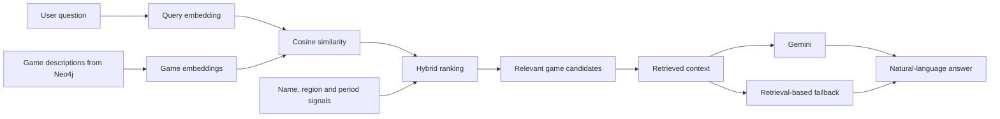
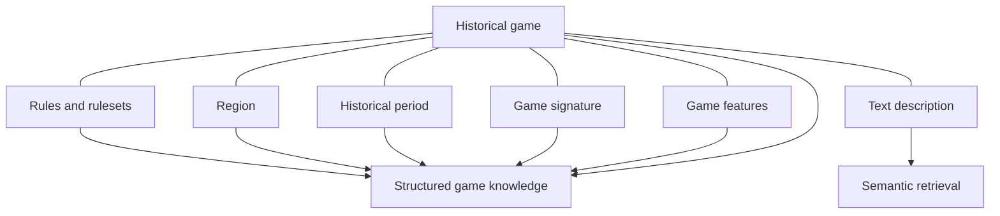
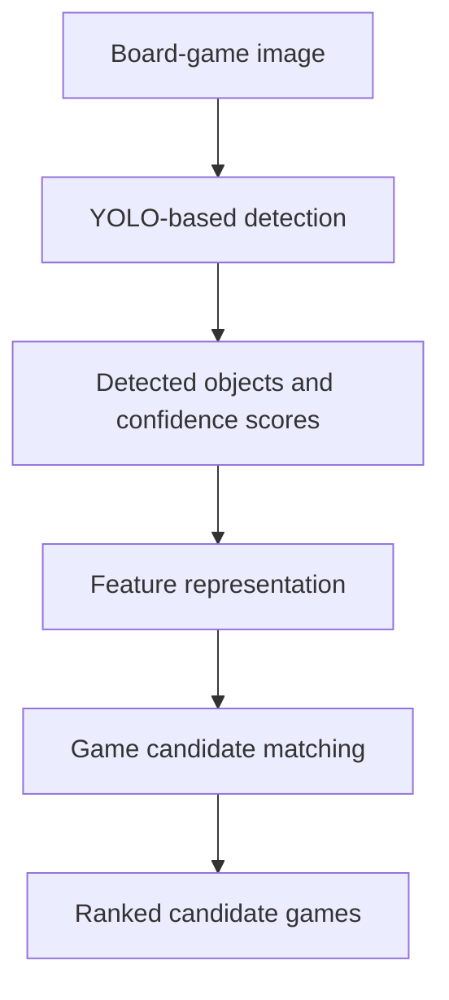
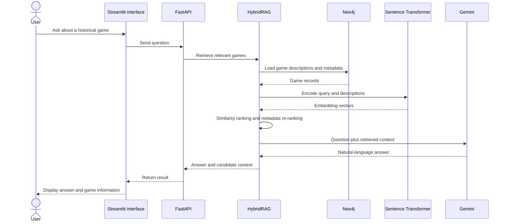

# LUDII Game Intelligence
### AI-powered exploration of historical board games

LUDII Game Intelligence brings together semantic retrieval, structured game knowledge, large-language-model-assisted question answering, computer vision, and 3D board representation to make historical board games easier to explore.

Inspired by the rich domain of [Ludii](https://ludii.games/), the project connects natural-language questions with game descriptions and metadata, helping users discover relevant games and explore their rules, regions, historical periods, and visual characteristics.

Rather than treating each game as an isolated record, LUDII Game Intelligence brings together complementary AI techniques and structured knowledge in one exploration workflow.

## Highlights

- **Semantic search:** discover games through the meaning of a question or description, not only exact keyword matches.
- **Hybrid retrieval:** combine embedding-based similarity with metadata-aware ranking to identify relevant candidate games.
- **LLM-assisted answers:** use retrieved game information as context for natural-language responses with Gemini.
- **Knowledge graph:** organize games and related concepts such as rules, regions, periods, signatures, and features in Neo4j.
- **Computer vision:** apply YOLO-based detection to visual elements in board-game imagery and support game-identification workflows.
- **3D board representation:** explore board geometry and 3D asset export through the project's 3D components.
- **Interactive access:** expose AI functionality through an API and a Streamlit interface.

## AI architecture



The architecture brings together three complementary forms of intelligence: language-based retrieval, structured domain knowledge, and visual analysis. Semantic retrieval uses game descriptions and metadata to find relevant candidates, while the vision and 3D components extend exploration beyond text.

## 1. Semantic retrieval and hybrid RAG

At the heart of the project is `HybridRAG`, implemented in `phase1_ludii_rag/hybrid_rag.py`.

The pipeline transforms a natural-language question into a semantic representation, compares it with representations of game descriptions, and ranks candidate games. Metadata-related heuristics can further adjust ranking using signals such as game name, region, or historical period. Retrieved information can then be supplied to Gemini to produce a natural-language response.



### How the retrieval pipeline works

1. **Knowledge retrieval:** game records and available metadata are loaded from Neo4j.
2. **Text representation:** game descriptions are prepared from available properties.
3. **Semantic embedding:** `all-MiniLM-L6-v2`, through Sentence Transformers, encodes the query and game descriptions into vectors.
4. **Similarity ranking:** cosine similarity ranks games according to semantic relevance.
5. **Hybrid re-ranking:** explicit metadata signals, including name, region, and period matches, can influence candidate ordering.
6. **Contextual answer generation:** retrieved game context is passed to Gemini when configured, enabling natural-language responses informed by the retrieved information.
7. **Fallback response:** a retrieval-based response path keeps candidate information available when LLM generation is unavailable.

Combining semantic similarity and explicit metadata signals makes retrieval more flexible than exact keyword search alone. The LLM adds a conversational layer on top of the retrieved game knowledge.

## 2. Knowledge graph for historical game knowledge

Neo4j provides the structured knowledge layer. The project's import scripts organize game records and associated information, including signatures, regions, periods, rules, and features.

The graph provides a domain-oriented representation of historical games: game entities can be connected to the information that describes them, giving retrieval a structured source of game knowledge alongside natural-language descriptions.



The repository documentation describes a collection containing:

- **1,621 games**
- **3,337 rulesets**
- **Approximately 16,739 relationships**
- **28 regions**
- **13 historical periods**

These figures illustrate the scale and variety of the domain knowledge represented in the project.

## 3. Computer vision for board-game analysis

The project's `phase2_vision/` components explore YOLO-based detection for board-game imagery, including board- and piece-related analysis. The API also includes a game-identification workflow that works with visual features.



The computer-vision direction complements semantic search: instead of starting only from a written question, a user can explore the visual structure of a board and use detected features as signals for identifying candidate games.

## 4. 3D board representation

The repository includes 3D-related code and a `reconstructed.glb` asset, exploring the representation and export of board geometry with tools such as Trimesh.


This component adds a spatial dimension to the project. Alongside text retrieval and visual analysis, 3D representation offers a way to work with board structure as a digital object.

## 5. End-to-end AI exploration flow

The following sequence shows how a natural-language question moves through the main retrieval and answer-generation components.



The application environment also exposes visual-analysis functionality through its API, allowing text-based and vision-oriented workflows to be explored through a common interface.

## 6. Repository guide

| Path | Purpose |
|---|---|
| `phase1_ludii_rag/hybrid_rag.py` | Semantic retrieval, hybrid ranking, and LLM-assisted question answering |
| `phase2_vision/` | YOLO-oriented board and piece detection components |
| `phase3_api/` | FastAPI endpoints for retrieval, game identification, and related functionality |
| `phase4_neo4j/` | Data preparation and import scripts for the game knowledge graph |
| `phase5_n8n/` | Workflow automation components |
| `phase6_advanced/` | Additional AI and data-related experiments |
| `models/` | Model-related assets |
| `tests/` | Automated tests |
| `app.py` | Streamlit user interface |
| `reconstructed.glb` | 3D asset included in the repository |

## 7. Technology stack

| Area | Technologies |
|---|---|
| Semantic AI | Python, Sentence Transformers, `all-MiniLM-L6-v2`, cosine similarity |
| LLM integration | Gemini |
| Knowledge representation | Neo4j, graph-based domain data |
| Computer vision | YOLO-based detection |
| 3D representation | Trimesh, GLB |
| API layer | FastAPI |
| Interactive interface | Streamlit |
| Data and runtime environment | Python tooling, Docker Compose |

## 8. Run the prototype

### Create a Python environment

Python 3.11 is a suitable starting point for the documented environment.

```bash
python -m venv .venv
```

Windows PowerShell:

```powershell
.\.venv\Scripts\Activate.ps1
pip install -r requirements.txt
```

macOS/Linux:

```bash
source .venv/bin/activate
pip install -r requirements.txt
```

### Start the knowledge database

Use the repository's `docker-compose.yml` to configure the supporting services. Set Neo4j credentials and any required API keys through local environment variables.

### Import game data

After the source datasets and database configuration are in place, the repository's import scripts can be used to populate the knowledge graph:

```bash
python phase4_neo4j/import_mysql_to_neo4j.py
python phase4_neo4j/import_lud_signatures.py
python phase4_neo4j/import_regions_periods.py
python phase4_neo4j/import_rules_features.py
```

### Start the API

```bash
uvicorn phase3_api.main:app --reload --host 127.0.0.1 --port 8000
```

FastAPI's interactive documentation is available at:

`http://localhost:8000/docs`

### Start the interface

In a separate terminal:

```bash
streamlit run app.py
```

## 9. Example use cases

- **Discover games by description:** ask for games sharing characteristics described in natural language.
- **Explore historical context:** search for games associated with a region or historical period.
- **Find related games:** use semantic similarity and metadata signals to surface candidate games.
- **Ask questions about game knowledge:** use retrieved records as context for Gemini-assisted responses.
- **Explore board imagery:** use visual detection components to analyze board-game images and support candidate identification.
- **Represent board geometry:** work with 3D board representations and GLB assets.

## Data source

[Ludii — General Game System](https://ludii.games/)

Ludii provides the historical board-game domain that inspires this project. LUDII Game Intelligence explores how semantic AI, structured knowledge, language models, and visual analysis can make that domain easier to search and understand.
