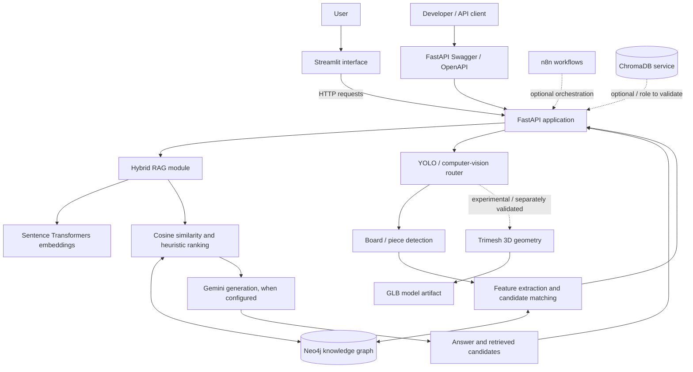
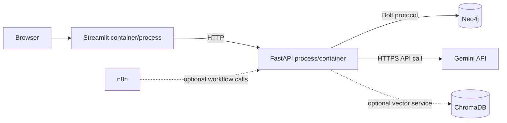
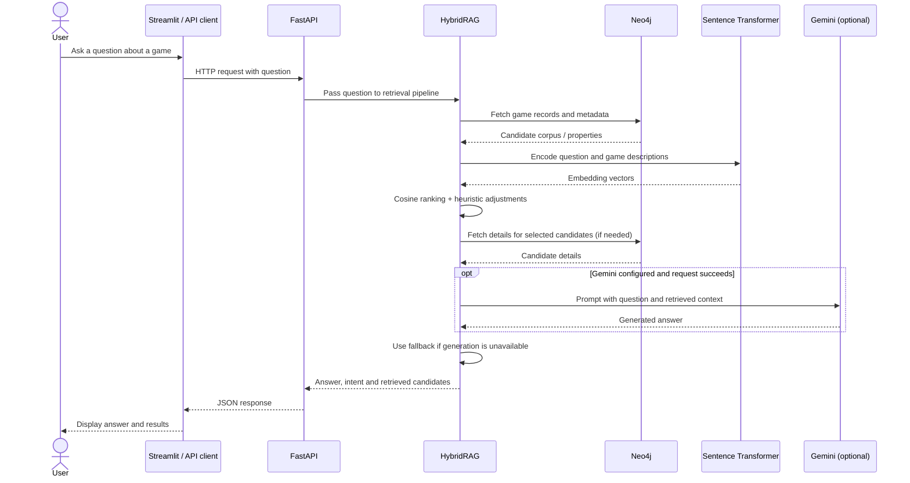
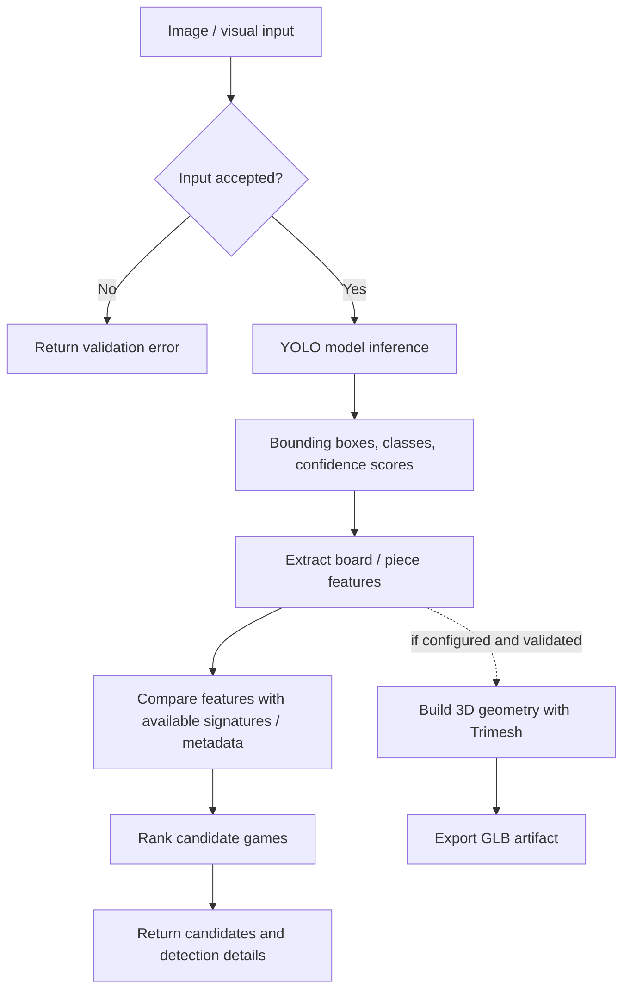
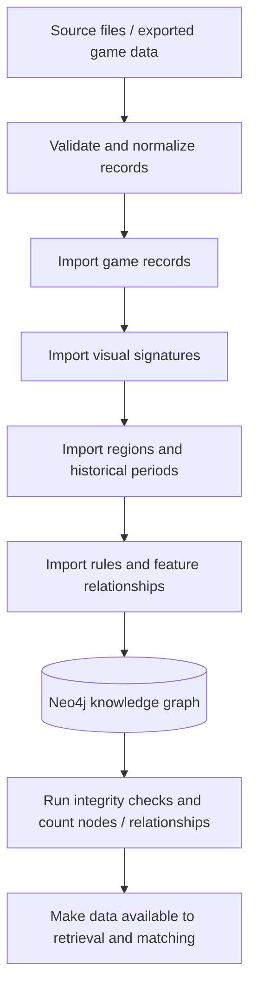

# LUDII Game Intelligence

### AI-powered exploration of historical board games

**Identify · Retrieve · Contextualize · Explore**

LUDII Game Intelligence is an AI-oriented software project exploring how computer vision, semantic retrieval, a graph database and large language models can work together to support the identification and exploration of historical board games.

The project brings together game metadata, rules, regions, periods and visual characteristics through a backend API and an interactive interface. It also contains experimental components for visual board analysis and 3D reconstruction.

> **Project status:** research/portfolio prototype. This README describes the repository structure and implementation paths inspected so far. It does not claim that every component is production-ready or that any unreported accuracy or performance target has been achieved. Run the validation steps below before presenting quantitative results.

**Repository:** https://github.com/salma12814/ludii-game-intelligence

**Local API documentation:** http://localhost:8000/docs (when the API is running)

---

## Contents

- [1. Problem and objectives](#1-problem-and-objectives)
- [2. Main capabilities](#2-main-capabilities)
- [3. System architecture](#3-system-architecture)
- [4. End-to-end data flows](#4-end-to-end-data-flows)
- [5. Technology stack](#5-technology-stack)
- [6. Repository structure](#6-repository-structure)
- [7. Setup](#7-setup)
- [8. Run the application](#8-run-the-application)
- [9. API examples](#9-api-examples)
- [10. Hybrid RAG: implementation overview](#10-hybrid-rag-implementation-overview)
- [11. Data and evaluation](#11-data-and-evaluation)
- [12. Security and known limitations](#12-security-and-known-limitations)
- [13. Roadmap](#13-roadmap)
- [14. Contribution](#14-contribution)

## 1. Problem and objectives

Historical board games are documented through different kinds of information: descriptions, rules, geographical origins, historical periods, board layouts and pieces. A keyword search alone may fail to connect these pieces of information or answer questions phrased in natural language.

LUDII Game Intelligence explores a modular solution that aims to:

1. organize game metadata and relationships in a Neo4j knowledge graph;
2. retrieve relevant games from natural-language queries using semantic embeddings and ranking heuristics;
3. use retrieved information as context for an LLM-generated answer;
4. expose backend capabilities through a REST API and interactive interface;
5. experiment with YOLO-based visual detection and 3D board reconstruction.

The application is intended as an exploration and decision-support tool. Generated answers and candidate identifications should be checked against their source data; they are not a substitute for historical or archaeological expert validation.

## 2. Main capabilities

### 2.1 Semantic search and question answering

The `phase1_ludii_rag/hybrid_rag.py` module contains the `HybridRAG` implementation. The inspected code:

- retrieves game records and metadata from Neo4j;
- builds text descriptions from selected metadata fields;
- encodes descriptions using Sentence Transformers and `all-MiniLM-L6-v2`;
- ranks candidates using cosine similarity;
- adjusts ranking using heuristic signals such as game name, region and period;
- can pass retrieved context to Gemini to generate a natural-language response;
- includes a fallback response path if the LLM is unavailable or disabled;
- keeps computed embeddings in memory for reuse within the lifetime of the instance.

Retrieval quality depends on the completeness of the graph, the representation of each game, and the ranking and filtering rules. LLM output should be assessed for relevance and factual faithfulness.

### 2.2 Visual detection and game identification

The `phase2_vision/` area contains YOLO-oriented detection code for board/game elements. The API includes an identification router. The intended workflow is to detect visual features and use them to help identify candidate games.

The exact integration between raw image upload, YOLO detections, board-feature extraction, graph matching and the final response must be confirmed against the endpoint implementation and tested with representative images. Do not infer a measured identification accuracy from the existence of the model or scripts alone.

### 2.3 Knowledge graph

Neo4j is used to store game records and their relationships to descriptive and historical metadata. Import scripts under `phase4_neo4j/` are intended to populate the graph with game information, signatures, regions, periods and rule-related features.

The imported graph should be validated after each pipeline stage. Report node and relationship counts only after measuring them against the actual database instance used for the demo.

### 2.4 3D reconstruction

The vision module includes a Trimesh-based board geometry/export component, and the repository contains a `reconstructed.glb` artifact. This demonstrates that a 3D artifact is included in the project; it does not by itself prove that every image-identification request automatically generates a correct reconstruction. Validate that connection with an end-to-end test before claiming it as a complete automated pipeline.

### 2.5 REST API and interface

FastAPI provides an API entry point and OpenAPI/Swagger documentation. A Streamlit application in `app.py` provides an interactive UI and calls the backend over HTTP. Docker Compose also defines supporting services, including Neo4j, ChromaDB and n8n.

A feature should be considered available only when its route is registered, its dependencies are configured and its behavior has been tested. Routes mentioned in documentation or response metadata are not proof that the corresponding endpoint is mounted and operational.

## 3. System architecture

### 3.1 Logical component view



**How to read this diagram:** solid arrows show the principal logical request/data path described by the repository's components. Dashed connections indicate optional or experimental integrations whose use in the main execution path should be verified. The diagram is an architecture view, not a guarantee that every service is active in every deployment.

### 3.2 Responsibilities by layer

| Layer | Component | Responsibility |
|---|---|---|
| Presentation | Streamlit (`app.py`) | User interaction, displaying API results and visualizations |
| API | FastAPI (`phase3_api/main.py`) | HTTP endpoints, request/response handling, OpenAPI docs |
| Retrieval | `HybridRAG` | Query preparation, embedding, candidate ranking and answer construction |
| Semantic model | Sentence Transformers | Convert query and game descriptions to vector representations |
| Generation | Gemini API | Generate a contextual answer from retrieved candidates, when configured |
| Knowledge storage | Neo4j | Persist games and graph relationships used by retrieval/import scripts |
| Computer vision | YOLO / OpenCV / PyTorch | Detect visual elements in board-game images |
| 3D processing | Trimesh / GLB | Build or export board geometry in the relevant reconstruction path |
| Supporting services | Docker Compose, n8n, ChromaDB | Local service orchestration and optional integrations |

### 3.3 Deployment view



The repository's current Streamlit code uses `http://localhost:8000` as its API URL. That is appropriate only when the browser-facing Streamlit process can reach the API at that address. In a multi-container deployment, `localhost` refers to the current container, so use a configurable API base URL and the correct Compose service name.

## 4. End-to-end data flows

### 4.1 Text query → retrieved games → answer



**Important implementation detail:** the inspected RAG code uses in-memory embeddings. Depending on how the `HybridRAG` object is initialized and reused, it may reload data or recompute embeddings after a restart or across separately created instances. A persistent vector index and an explicit refresh strategy would make this behavior more predictable as the corpus grows.

### 4.2 Image → detection → candidate identification



This is the intended conceptual flow. Before describing it as fully automated, verify that the actual endpoint accepts an image, invokes the detector, maps its outputs to the candidate-matching function and returns the expected response. If the endpoint currently accepts JSON features rather than a file, document the JSON contract separately from image-upload behavior.

### 4.3 Dataset import → Neo4j graph



The script sequence shown here follows the import stages named in the repository. Confirm each script's exact input files, idempotency and prerequisites before running it. After import, check for duplicates, missing properties, orphan relationships and unexpected counts.

### 4.4 API request lifecycle

1. The client sends an HTTP request to a registered FastAPI endpoint.
2. The endpoint validates parameters and calls the relevant service/router.
3. The service uses Neo4j and/or model providers as configured.
4. Exceptions and unavailable dependencies should be translated into stable HTTP error responses.
5. The API returns a documented JSON response to the UI or client.

The health endpoint should eventually report dependency readiness separately from process liveness. A successful HTTP response alone does not prove that Neo4j, the model weights or Gemini are available.

## 5. Technology stack

| Area | Technology | Purpose |
|---|---|---|
| Language | Python | Core services and integration |
| REST API | FastAPI, Uvicorn, Pydantic | HTTP routes, validation and interactive API documentation |
| Embeddings | Sentence Transformers, `all-MiniLM-L6-v2` | Semantic representations for retrieval |
| Ranking | NumPy / scikit-learn utilities | Vector similarity and ranking support |
| LLM | Gemini API | Contextual answer generation when enabled |
| Graph database | Neo4j, Python driver | Game metadata and graph relationships |
| Computer vision | Ultralytics YOLO, OpenCV, PyTorch | Visual detection and image processing |
| UI | Streamlit, Requests, Pandas, Plotly | Interactive interface and result visualization |
| 3D | Trimesh, GLB | Board geometry and 3D export |
| Supporting services | Docker Compose, n8n, ChromaDB | Local service management and optional workflows/vector storage |

Use `requirements.txt` and the container files as the source of truth for installed versions. A library appearing in dependencies does not necessarily mean it is used by the primary request path.

## 6. Repository structure

```text
ludii-game-intelligence/
├── phase1_ludii_rag/
│   └── hybrid_rag.py              # Semantic retrieval and answer generation
├── phase2_vision/
│   ├── board_detector.py          # Board detection logic
│   ├── piece_detector.py          # Piece detection logic
│   ├── board_3d.py                # 3D geometry / export logic
│   └── detect.py                  # Detection script / entry point
├── phase3_api/
│   ├── main.py                    # FastAPI application entry point
│   ├── identify_game_from_yolo.py # Identification router
│   ├── hybrid_rag_routes.py       # RAG routes
│   ├── historical_search.py       # Historical search module; router mounting to verify
│   ├── gnn_routes.py              # GNN-related module; router mounting to verify
│   └── schemas.py                 # Pydantic schemas
├── phase4_neo4j/
│   ├── pipeline.py                # Database pipeline utilities
│   ├── import_mysql_to_neo4j.py   # Game data import
│   ├── import_lud_signatures.py   # Signature import
│   ├── import_regions_periods.py  # Region / period import
│   └── import_rules_features.py   # Rules / feature import
├── phase5_n8n/                    # Workflow automation
├── phase6_advanced/               # Advanced / experimental modules
├── models/                        # Model files or artifacts
├── tests/                         # Test suite
├── app.py                         # Streamlit UI
├── Dockerfile
├── docker-compose.yml
├── requirements.txt
├── reconstructed.glb              # Example 3D artifact
└── README.md
```

This is a documentation-oriented overview. Confirm current filenames and their actual contents on the target branch before treating every entry as an active runtime component.

## 7. Setup

### Prerequisites

- Python 3.11 is a reasonable starting point, subject to the dependency constraints in the repository.
- Git.
- Neo4j 5.x or the version configured in Compose.
- Docker and Docker Compose if using the containerized supporting services.
- A Gemini API key if LLM generation is enabled.
- Model weights and network access for first-time downloads, where required.

### 7.1 Clone the repository

```bash
git clone https://github.com/salma12814/ludii-game-intelligence.git
cd ludii-game-intelligence
```

### 7.2 Create a virtual environment

**Windows PowerShell**

```powershell
py -3.11 -m venv .venv
.\.venv\Scripts\Activate.ps1
python -m pip install --upgrade pip
pip install -r requirements.txt
```

If PowerShell script activation is blocked, use a permitted shell or `cmd.exe`:

```bat
.venv\Scripts\activate.bat
```

**Linux / macOS**

```bash
python3.11 -m venv .venv
source .venv/bin/activate
python -m pip install --upgrade pip
pip install -r requirements.txt
```

If dependency installation fails, verify Python compatibility and the pinned versions, particularly PyTorch, Transformers and Sentence Transformers. Avoid upgrading every dependency at once without running the test suite.

### 7.3 Configure environment variables

Create a local `.env` file and never commit real credentials:

```dotenv
NEO4J_URI=bolt://localhost:7687
NEO4J_USER=neo4j
NEO4J_PASSWORD=replace_with_a_local_password
GEMINI_API_KEY=replace_with_your_key
```

These names are used by the inspected RAG module. Check other scripts for additional configuration variables. A `.env.example` containing placeholders should be committed; the actual `.env` should be ignored by Git.

### 7.4 Start Neo4j

Review `docker-compose.yml` first and replace demo credentials before launching services:

```bash
docker compose up -d neo4j
docker compose ps
```

Depending on the Compose configuration, Neo4j Browser is typically available at `http://localhost:7474` and Bolt at `bolt://localhost:7687`.

### 7.5 Import the graph data

The repository documentation describes the following import stages:

```bash
python phase4_neo4j/import_mysql_to_neo4j.py
python phase4_neo4j/import_lud_signatures.py
python phase4_neo4j/import_regions_periods.py
python phase4_neo4j/import_rules_features.py
```

Run these commands only after confirming their required source files and configuration. Check each exit status and inspect the resulting graph before starting retrieval. If an import script is not idempotent, avoid running it repeatedly without a cleanup or duplicate-handling strategy.

## 8. Run the application

### 8.1 Start FastAPI

From the repository root, with the virtual environment active:

```bash
uvicorn phase3_api.main:app --reload --host 127.0.0.1 --port 8000
```

- API root: `http://localhost:8000`
- Swagger UI: `http://localhost:8000/docs`
- OpenAPI schema: `http://localhost:8000/openapi.json`
- Health endpoint: `http://localhost:8000/health`

`--reload` is intended for local development, not production deployment.

### 8.2 Start Streamlit

Open another terminal from the repository root:

```bash
streamlit run app.py
```

The current UI code points to `http://localhost:8000`. For deployment or container-to-container communication, make the API base URL configurable through an environment variable.

### 8.3 Optional services

The Compose file also defines supporting services such as ChromaDB and n8n. To start all declared services:

```bash
docker compose up -d
docker compose ps
docker compose logs -f
```

Only start services needed for the scenario being tested. Confirm exposed ports, persistent volumes, credentials and service names before sharing a deployment configuration.

## 9. API examples

Use the running API's `/docs` page as the authoritative source for the endpoint paths and schemas in your current checkout.

### Health check

```bash
curl http://localhost:8000/health
```

A health response is useful for checking process availability. It should not be interpreted as a successful dependency check unless the endpoint actively checks those dependencies.

### API metadata

```bash
curl http://localhost:8000/
```

### RAG question

The repository documentation gives the following example; confirm the exact route and query parameter in `/docs` before use:

```bash
curl --get "http://localhost:8000/api/v1/rag/ask" \
  --data-urlencode "question=Explain the rules of Senet"
```

### Identification from JSON features

The documented example submits board characteristics as JSON rather than uploading an image:

```bash
curl -X POST "http://localhost:8000/api/v1/identify_game_from_yolo" \
  -H "Content-Type: application/json" \
  -d '{"board_cols":8,"board_rows":8,"total_pieces":32,"pieces":[]}'
```

Treat this as an example contract to verify against the currently registered endpoint. It is not an image-upload example. For image inference, use the upload endpoint and schema actually declared by the code, if available.

## 10. Hybrid RAG: implementation overview

The `HybridRAG` class combines retrieval and generation rather than relying on the LLM alone.

### Stage A — Build a searchable corpus

The module queries Neo4j for game records and selected metadata, then creates text representations for embedding. The exact fields depend on the Cypher query and the graph schema.

### Stage B — Encode descriptions and the query

`all-MiniLM-L6-v2` transforms the game descriptions and user question into dense vectors. The implementation retains embeddings in memory for reuse during the instance's lifetime.

### Stage C — Rank candidates

Cosine similarity produces an initial ranking. Additional heuristics can boost or filter candidates using recognizable game names, regions and historical periods. These rules are useful baselines, but they should be tested against annotated queries to understand their effect and avoid false matches.

### Stage D — Generate a grounded response

When Gemini is configured and the request succeeds, retrieved candidates are used as context for response generation. The module also has a fallback response path for cases where the LLM is unavailable. The fallback is not equivalent to a full generative answer.

### Stage E — Return the result

The module returns an answer together with information about the query and retrieved candidates. API schemas should make the response shape explicit and stable for the UI.

### Current engineering considerations

- Intent and region detection based on keyword lists is heuristic, not a dedicated intent model.
- Similarity thresholds and ranking bonuses require validation on representative queries.
- In-memory embeddings are lost on restart and may be recomputed if the object is recreated.
- The system should preserve provenance so users can inspect which records support an answer.
- LLM answers need safeguards against unsupported claims and should distinguish retrieved facts from generated interpretation.
- Neo4j driver/session lifecycle should be managed explicitly, with resources closed reliably.

## 11. Data and evaluation

The repository's previous README documents the following approximate corpus figures. These are **reported documentation values**, not counts independently recomputed during this review.

| Documented metric | Reported value |
|---|---:|
| Games | 1,621 |
| Rule sets | 3,337 |
| YOLO signatures | 486 in the data section |
| Regions | 28 |
| Historical periods | 13 |
| Categories | 52 |
| Graph relationships | approximately 16,739 |

The repository summary and UI documentation have also displayed different totals. Recompute the counts from the actual imported database and use a single source of truth before publishing these numbers. Document corpus provenance, date, cleaning steps, duplicates, missing fields and count definitions.

### Metrics worth reporting after measurement

| Component | Suggested evaluation |
|---|---|
| Semantic retrieval | Precision@k, Recall@k, MRR or nDCG on an annotated query set |
| YOLO detection | Precision, Recall, mAP@50 and mAP@50-95 on a held-out test set |
| RAG answers | Context faithfulness, factual correctness, relevance and latency |
| API | Response latency, error rate and behavior under load |
| 3D reconstruction | Valid exports, successful cases and qualitative review against expected geometry |

Do not publish a score unless you can describe the test data, split, model version, evaluation procedure and calculation method.

## 12. Security and known limitations

The following points were identified in the inspected code/configuration and should be addressed before exposing the service publicly.

1. **Default Neo4j credentials:** the RAG module and Compose configuration contain demo/default credentials. Remove hard-coded fallback secrets, use environment variables, and rotate credentials that have been used in a public repository.
2. **CORS policy:** the FastAPI entry point uses a permissive all-origins configuration with credentials. Configure an explicit allowlist for trusted frontend origins before deployment.
3. **Frontend API URL:** `app.py` contains a fixed `http://localhost:8000` base URL. Make it environment-configurable, particularly for containers and remote deployments.
4. **Input validation:** impose file-size/type limits for image endpoints, validate request payloads and return safe, consistent errors.
5. **Dependency maintenance:** review the pinned dependency versions and known vulnerabilities; update deliberately and run regression tests.
6. **Secrets and logs:** never commit `.env`, API keys or database passwords, and avoid logging credentials or sensitive request content.
7. **Health and readiness:** distinguish process liveness from dependency readiness. A useful readiness check should verify critical services safely.
8. **Route registration:** verify that all routers expected by the documentation are included in `phase3_api/main.py`. Modules such as historical-search or GNN routes should not be described as API capabilities unless mounted and tested.
9. **Resource management:** ensure Neo4j drivers/sessions and model resources have a controlled lifecycle.
10. **Service boundaries:** clarify whether ChromaDB is actively used by the main RAG flow or merely declared as an optional service.

This is a targeted code-review checklist, not a complete security audit.

## 13. Roadmap

### P0 — Make the current version safe and reproducible

- [ ] Remove hard-coded credentials and add `.env.example`.
- [ ] Fix CORS for local and deployed environments.
- [ ] Make the frontend API URL configurable.
- [ ] Verify route registration and document actual endpoint schemas.
- [ ] Add clear setup instructions and check them from a clean environment.
- [ ] Add automated smoke tests for API startup and health.

### P1 — Prove the AI workflow

- [ ] Create a small, versioned set of representative natural-language queries with expected games.
- [ ] Measure retrieval quality before tuning ranking heuristics.
- [ ] Test Gemini-disabled and provider-error fallback behavior.
- [ ] Create a held-out image test set for YOLO and report standard detection metrics.
- [ ] Trace one image from input to detection, matching and final API output.
- [ ] Validate that exported GLB files can be opened and correspond to expected geometry.

### P2 — Improve maintainability and scale

- [ ] Separate API routers, service logic, configuration and data-access code cleanly.
- [ ] Introduce structured logging and consistent error responses.
- [ ] Add CI for formatting/linting, unit tests and dependency checks.
- [ ] Consider persistent vector indexing and an explicit data/embedding refresh strategy.
- [ ] Add retrieval provenance and expose source records to the user.
- [ ] Pin container image versions and document volumes, networks and startup dependencies.

### P3 — Improve the portfolio presentation

- [ ] Add real screenshots of the interface, Swagger, graph and 3D output.
- [ ] Record a short demo of one complete scenario.
- [ ] Add an architecture diagram and a sequence diagram to the repository.
- [ ] Explain what is implemented, experimental and planned.
- [ ] Include reproducible evaluation results only after running the experiments.

## 14. Contribution

1. Create a focused branch.
2. Keep changes small and explain the rationale.
3. Add or update tests for changed behavior.
4. Run the relevant checks locally.
5. Open a pull request describing the change and test results.

Example documentation update:

```bash
git checkout -b docs/improve-readme
git add README.md
git commit -m "docs: improve project documentation"
git push -u origin docs/improve-readme
```

## License

The earlier README mentions the MIT License. Confirm that a `LICENSE` file exists and matches that declaration before redistributing the project or retaining the license badge.

---

**LUDII Game Intelligence** — a portfolio project exploring the integration of AI components into a modular software application.
